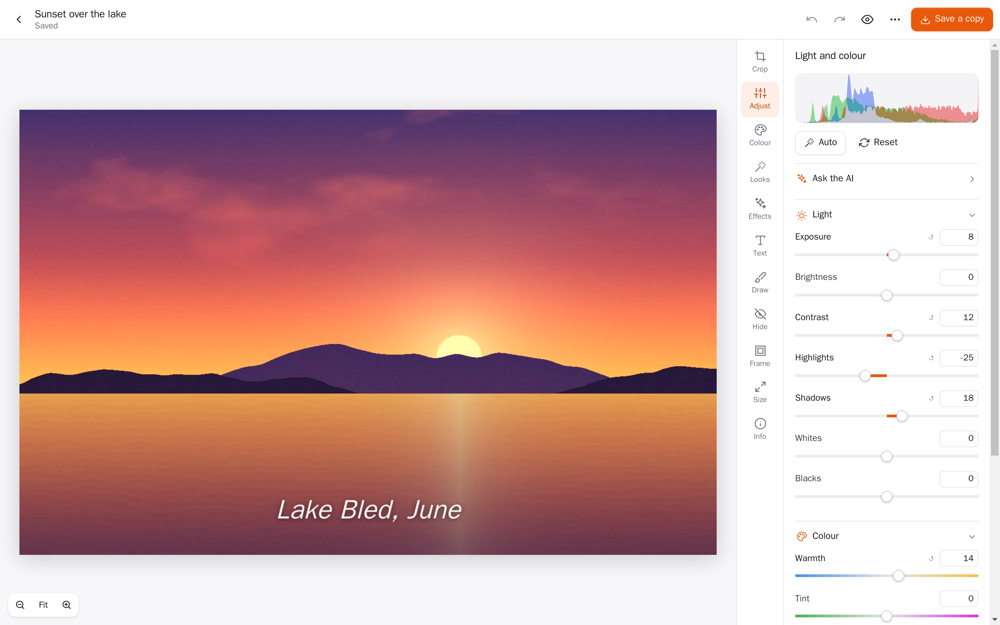
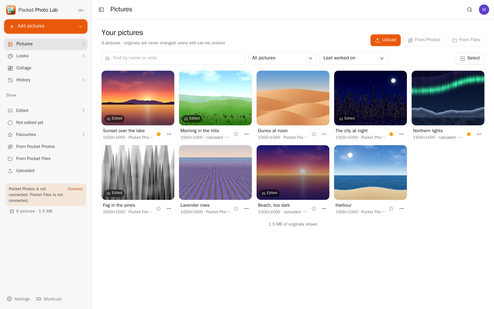
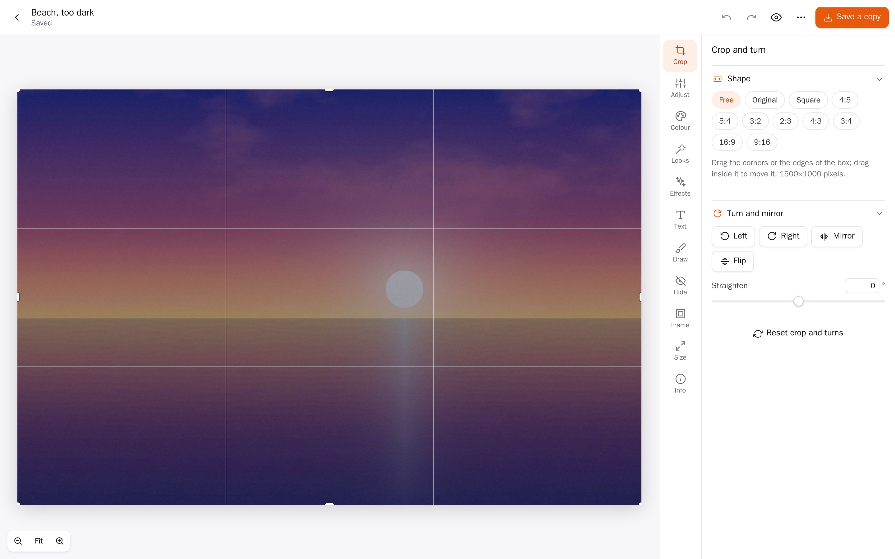
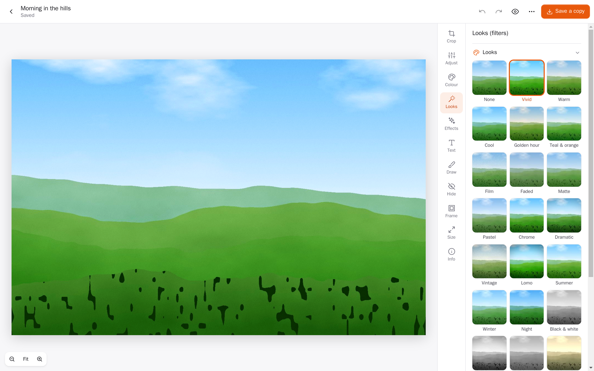
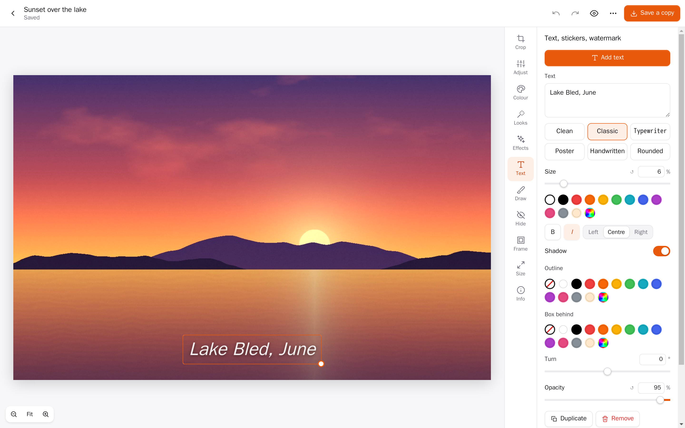
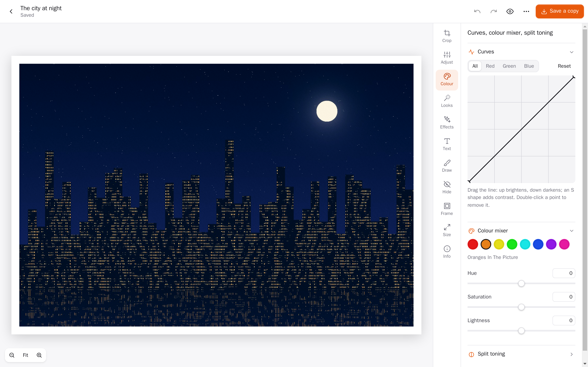
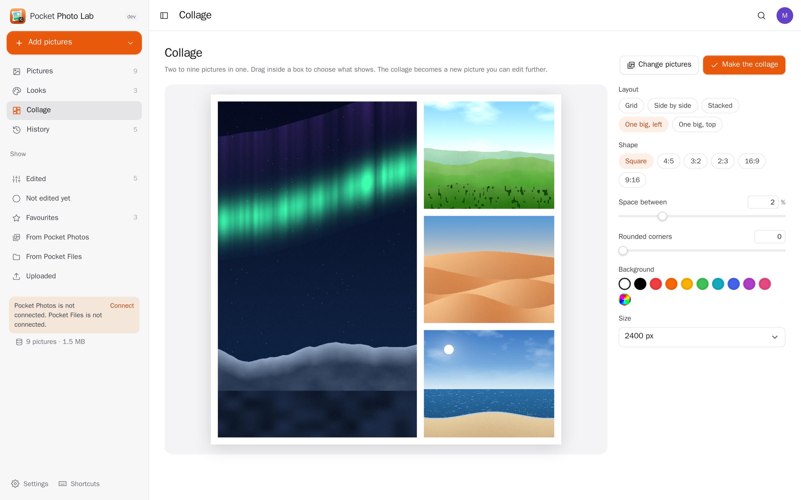
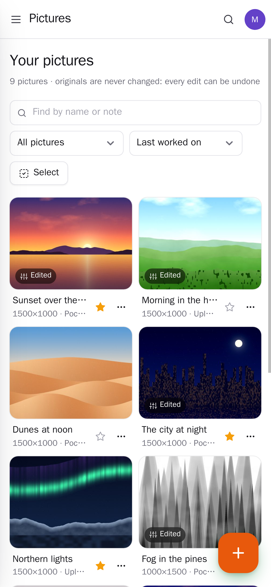
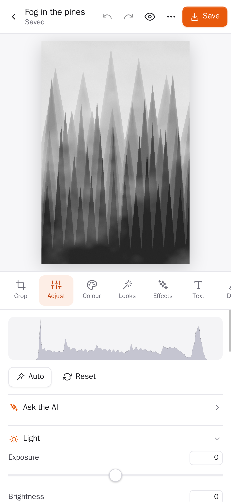
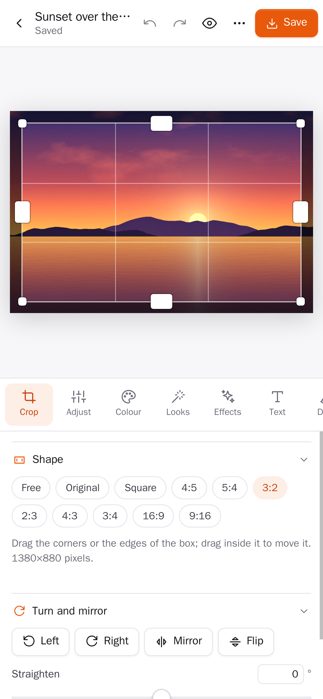

<p align="center"></p>
<h1 align="center">Pocket Photo Lab</h1>
<p align="center">A picture editor on your own server. Bring a photo in from Pocket Photos, Pocket Files, your phone's share sheet or an upload, then crop, straighten, turn and resize it, fix the light and colour with sliders, curves and a colour mixer, put on a look, add text, stickers, arrows and drawings, blur out faces and number plates, give it a frame or fit it to a square post, and save a copy back to Pocket Photos, Pocket Files or your device. Collages and batch edits too. The original is never changed: every edit is kept as a recipe you can undo, revisit and save as versions.<br>One Go binary, one SQLite file, one volume. Part of the Pocket apps; works on its own too.</p>
<p align="center">
  <a href="https://github.com/abjelosevic88/pocket-homelab-photo-lab/actions"></a>
  <a href="https://github.com/abjelosevic88/pocket-homelab-photo-lab/pkgs/container/pocket-homelab-photo-lab"></a>
  <a href="LICENSE"></a>
</p>

---

<p align="center"></p>

<table>
  <tr>
    <td width="50%"></td>
    <td width="50%"></td>
  </tr>
  <tr>
    <td align="center"><sub>Your pictures, from Pocket Photos, Pocket Files and uploads; drop or paste to add more.</sub></td>
    <td align="center"><sub>Crop to any shape, turn, mirror and straighten the horizon.</sub></td>
  </tr>
  <tr>
    <td width="50%"></td>
    <td width="50%"></td>
  </tr>
  <tr>
    <td align="center"><sub>Twenty looks previewed on your own picture, mixed in at any strength; save your own.</sub></td>
    <td align="center"><sub>Text with six typefaces, outlines and boxes; stickers, a watermark, drawings and arrows.</sub></td>
  </tr>
  <tr>
    <td width="50%"></td>
    <td width="50%"></td>
  </tr>
  <tr>
    <td align="center"><sub>Curves per channel, an eight-colour mixer and split toning.</sub></td>
    <td align="center"><sub>Collages of two to nine pictures, in layouts, shapes and colours of your choice.</sub></td>
  </tr>
</table>

<p align="center">
  &nbsp;&nbsp;
  &nbsp;&nbsp;
  
</p>

## What it does

- **Bring pictures in**: upload (JPEG, PNG, WebP, GIF, AVIF, BMP, TIFF; HEIC in Safari), drop them anywhere, paste a screenshot, share from a phone to the installed app, pick from your Pocket Photos library (search by description) or from Pocket Files folders. Pocket Photos' “Edit in Photo Lab” opens a photo here directly.
- **Crop and turn**: free or fixed shapes (square, 4:5, 3:2, 16:9, 9:16 …), turn left and right, mirror, flip, straighten with automatic fill.
- **Light and colour**: exposure, brightness, contrast, highlights, shadows, whites, blacks, warmth, tint, vibrance, saturation, hue, clarity, dehaze, sharpening, noise reduction, vignette, grain, fade and blur; **Auto** levels and white balance; a live histogram.
- **Colour**: tone curves (all, red, green, blue), a colour mixer for eight colours (hue, saturation, lightness) and split toning.
- **Looks**: twenty ready-made looks shown on your own picture, at any strength; save your own looks and put them on many pictures at once.
- **Effects**: black and white, sepia, duotone, negative, posterize, pixelate, miniature (tilt-shift), and making a colour see-through (a logo or a signature on white paper).
- **Text and drawing**: captions in six typefaces with colour, outline, a box behind, shadow, turn and opacity; stickers; a corner or all-over watermark; pen, marker, boxes, circles, lines and arrows.
- **Hide**: blur, pixelate or black out faces, number plates, addresses and screens; nothing underneath survives in the saved picture.
- **Frame and size**: borders, rounded corners, fitting the whole picture into a square or a story with a blurred background; resize by pixels, percent or common sizes.
- **Save a copy**: JPEG, PNG, WebP or AVIF, at a quality and size you choose, to this device, as a new photo in Pocket Photos or into a Pocket Files folder. No location or camera details leave with it.
- **Never lose anything**: undo and redo for every step, saving as you go, named versions, copies to try something else, hold to compare with the original or a before/after line.
- **Many at once**: select pictures, put one look and size on all of them, download them as a ZIP or send them to Photos or Files; collages of two to nine pictures.
- **AI, if you want it**: Pocket AI (or your OpenAI key) suggests an edit for a picture or describes it (a name and alt text).
- **Everyone their own**: each person has their own pictures, looks, settings and connections; admins see no one else's.

All the editing happens in your browser (a Web Worker does the pixels), so the server stays small; it keeps the originals, the edits and a rendered preview of each look.

## Run it

```sh
docker run -d --name pocket-photolab -p 8080:8080 -v ./data:/data \
  -e BASE_URL=https://photolab.example.com -e SECURE_COOKIES=true \
  ghcr.io/abjelosevic88/pocket-homelab-photo-lab:latest
```

or `docker compose up -d` with [docker-compose.yml](docker-compose.yml). Open it, create the first account and drop a picture on it. All options: [docs/configuration.md](docs/configuration.md). API and the edit format: [docs/api.md](docs/api.md). Backups: [docs/backup.md](docs/backup.md).

## With Pocket Core

Set `CORE_URL` and `CORE_REGISTRATION_KEY` and Photo Lab joins the box: people sign in with Pocket Core, and through app links each person reaches their own Pocket Photos (`photos:read`, `photos:write`: pick pictures, save edits back as new photos) and Pocket Files (`files:read`, `files:write`) with nothing to paste; Pocket AI suggests edits and describes pictures. Other apps can read your lab (`photolab:read`) or send pictures into it (`photolab:write`, Pocket Photos' “Edit in Photo Lab”). Events on the bus: `photolab.image_added`, `photolab.image_edited`, `photolab.image_exported`. Without Core every connection can be made directly with a URL and a token; the Core-only choices stay visible, greyed out.

## Develop

```sh
make dev     # API on :8080 with demo data + Vite on :5173
make test    # go vet, go test, tsc
make         # web + binary
```

MIT licensed.
